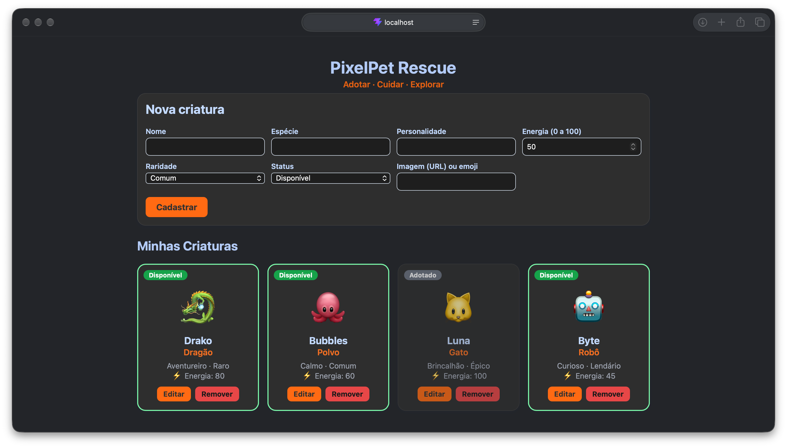

# PixelPet Rescue

Uma aplicação web para gerenciar criaturas virtuais, cuidar delas e explorar um sistema de adoção. Desenvolvido com React, JavaScript e CSS.

## Preview



## Funcionalidades

- Cadastro de criaturas
- Edição e remoção de criaturas
- Sistema de adoção
- Favoritos
- Filtros de busca
- Gerenciamento de energia
- Persistência de dados com LocalStorage
- Painel com estatísticas
- Sistema de conquistas

## Tecnologias

- React
- JavaScript
- CSS
- Vite
- LocalStorage

## Executando o projeto

Clone o repositório:

```bash
git clone https://github.com/thiagoeduardoolimpio/pixelpetrescue.git
```

Entre na pasta do projeto:

```bash
cd pixelpetrescue
```

Instale as dependências:

```bash
npm install
```

Inicie o servidor de desenvolvimento:

```bash
npm run dev
```

## Estrutura

```text
src/
├── components/
├── data/
├── utils/
├── App.jsx
├── main.jsx
└── index.css

docs/
└── prints/
    └── pixelpet-rescue.png
```

## Demonstração

[PixelPet Rescue — Acessar aplicação](https://pixelpetrecuethiagoolimpio.vercel.app)

---

Desenvolvido como projeto acadêmico de Tecnologia em Desenvolvimento de Internet.