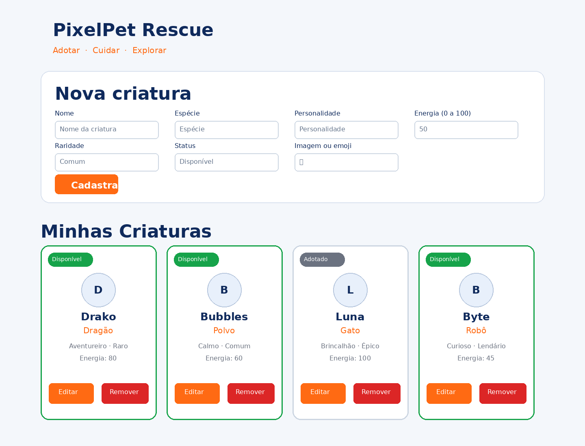

# PixelPet Rescue

PixelPet Rescue é uma aplicação web para cadastrar e administrar criaturas virtuais em uma central temática de adoção. O projeto foi desenvolvido para a disciplina **Tecnologia em Desenvolvimento de Internet II**, com JavaScript e React.

**Aplicação publicada:** https://pixelpetrecuethiagoolimpio.vercel.app

## Prévia da interface



> A imagem acima é uma prévia local ilustrativa, não uma captura de tela do site publicado. As capturas reais devem ser adicionadas em `docs/prints/`.

## Funcionalidades implementadas

- Listagem de criaturas em cartões.
- Cadastro de criaturas com validação dos campos.
- Edição dos registros existentes.
- Remoção com confirmação.
- Identificação visual de criaturas disponíveis e adotadas.
- Exibição de emoji ou imagem informada por URL.
- Mensagens de confirmação para as operações.
- Interface adaptável a telas menores.

Os dados são mantidos no estado da aplicação durante a sessão. Ainda não há persistência em `localStorage` ou banco de dados; ao recarregar a página, a lista volta aos registros iniciais.

## Tecnologias

- JavaScript (ES Modules)
- React
- Vite
- CSS
- Node.js e npm

## Como executar

É necessário ter Node.js instalado. Na pasta que contém `package.json`, execute:

```bash
npm install
npm run dev
```

Abra no navegador o endereço exibido pelo Vite (normalmente `http://localhost:5173`).

### Comandos disponíveis

| Comando | Finalidade |
|---|---|
| `npm run dev` | Inicia o servidor de desenvolvimento. |
| `npm run build` | Gera a versão de produção em `dist/`. |
| `npm run preview` | Abre uma prévia da versão de produção. |
| `npm run lint` | Executa o Oxlint. |
| `npm test` | Executa os testes automatizados. |

## Estrutura do projeto

```text
pets/
├── docs/
│   └── prints/
│       ├── 00-previa-local-ilustrativa.png
│       └── LEIA-ME.md
├── public/
├── src/
│   ├── components/
│   │   ├── PetCard.jsx
│   │   └── PetForm.jsx
│   ├── data/
│   │   ├── opcoes.js
│   │   └── pets.js
│   ├── utils/
│   │   └── validarPet.js
│   ├── App.jsx
│   ├── index.css
│   └── main.jsx
├── tests/
│   └── validarPet.test.js
├── index.html
├── package.json
├── package-lock.json
└── vite.config.js
```

## Organização do código

- `App.jsx`: mantém a lista de criaturas e controla cadastro, edição, remoção e mensagens.
- `PetCard.jsx`: apresenta os dados de uma criatura e suas ações.
- `PetForm.jsx`: controla os campos de cadastro e edição.
- `validarPet.js`: concentra as regras de validação dos dados.
- `data/pets.js`: contém os registros iniciais de demonstração.
- `data/opcoes.js`: centraliza as opções fixas do formulário.
- `index.css`: reúne os estilos e os ajustes responsivos.

## Regras de validação

Nome, espécie e personalidade são obrigatórios. Energia deve ser um número entre 0 e 100; os limites 0 e 100 são aceitos, mas o campo vazio não. A imagem é opcional: pode ser informada uma URL ou um emoji. Quando o campo fica vazio, o cartão usa `🐾`.

## Testes

Execute os testes da validação com:

```bash
npm test
```

Os casos automatizados verificam dados válidos, campos obrigatórios, energia vazia, valores não numéricos e os limites do intervalo.

## Capturas de tela

Guarde as imagens em `docs/prints/`. O README usa o caminho relativo `docs/prints/00-previa-local-ilustrativa.png`; ao adicionar uma captura real, use um nome descritivo e atualize o caminho da imagem acima, se desejar apresentá-la no README.

## Créditos

Projeto acadêmico com registros e criaturas fictícias.
